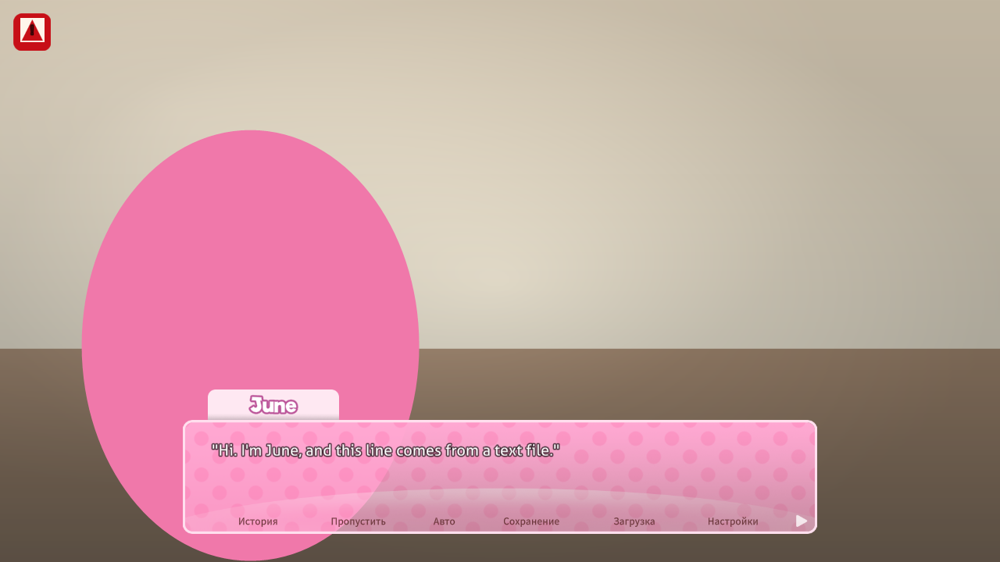

# StoryAPI

A scripting layer for **Doki Doki Literature Club Plus**.

The original DDLC was built in Ren'Py, which meant anyone could drop a folder of
`.rpy` files next to the game, write new scenes, add characters, swap in their own
pictures, and it just worked. DDLC Plus is a Unity/Mono port that kept the whole Ren'Py
story engine but shipped the scripts as compiled asset bundles, so that ease of use was
lost.

StoryAPI puts it back. You write plain `.rpy` files in a folder, and the plugin compiles
them into the game's own instruction format and registers them as ordinary labels. From
the story runner's point of view a mod label is indistinguishable from a shipped one:
custom dialogue renders in DDLC's own text box with its own typewriter effect, custom
sprites sit in its sprite layers with its depth sorting, and custom music plays on its
music channel.



## Status

Version 0.1.1, tested on the PC (Epic Games Store) release of DDLC+ in October 2026.
Story mods are still an early feature: back up your saves and expect rough edges.

## Install

The game is a Unity/Mono build, so it needs [BepInEx 5](https://github.com/BepInEx/BepInEx).

1. Close the game.
2. Download `BepInEx_win_x64_5.4.23.5.zip` and extract it into the game folder, next to
   `Doki Doki Literature Club Plus.exe`.
3. Download the release archive and extract it into the game folder, or copy the built
   `StoryAPI.dll` into `<game>\BepInEx\plugins\StoryAPI\`.
4. Put your mods in `<game>\BepInEx\plugins\StoryAPI\Mods\<your mod>\`.
5. Start the game. `BepInEx\config\storyapi.cfg` appears on first launch.

To uninstall, delete the `StoryAPI` folder.

### Building from source

The build references assemblies from an installed copy of the game. The default path
is the Epic Games Store location; override it for your install:

```
dotnet build src/StoryAPI/StoryAPI.csproj -c Release -p:GameDir="D:\Games\DokiDokiLitClubPlus"
```

The output is `src/StoryAPI/bin/StoryAPI.dll`. The project targets `netstandard2.0`
and needs the .NET SDK; BepInEx 5 supplies the runtime inside the game.

## Writing a mod

A mod is a folder containing one or more `.rpy` files and whatever art they mention.

```
Mods/
  my_story/
    story.rpy
    images/
      room.png
    audio/
      theme.ogg
```

### The language

```
# --- declarations -------------------------------------------------------

character june "June" image june      # a speaker of your own
image june = june.png                 # art that ships with the mod
audio june_theme = theme.ogg          # a track that ships with the mod

# --- a scene ------------------------------------------------------------

label my_scene:
    scene modclassroom                # background
    play june_theme fadein 1.0        # music (channel defaults to music)

    show june at left                 # a sprite, positioned
    hide june

    june "Hello. This is my own character speaking."
    m "And this is the real Monika, in the same scene."
    _ "Narration is written with a leading underscore."

    $ points = 3                      # a variable
    $ player_knows = True

    if points > 5:
        june "Plenty of points."
    elif points > 0:
        june "You have [points] points."     # [points] is interpolated
    else:
        june "No points at all."

    menu "What next?":
        "Keep talking":
            june "Sure."
        "Leave":
            jump my_farewell

    return

label my_farewell:
    stop music
    scene black
    june "Goodbye."
    return
```

### Variable declarations and loop control

StoryAPI supports a limited subset of Ren'Py variable declarations and loop statements:

```renpy
define june = Character("June")
define starting_points = 3
default points = 0
default has_key = False

# Scalar expressions are evaluated by DDLC+ when a mod label first executes.
define bonus_points = starting_points * 2
default can_enter = has_key and points >= 3
default optional_value = None

label example:
    $ points += 1
    while points < 3:
        $ points += 1
    return
```

Supported literal initializers are quoted strings, numbers, `True`, and `False`.
List literals (for example `[1, 2]`) and dictionaries with quoted-string keys (for example
`{"count": 2}`) can also be initialized, including nested lists/dictionaries and empty
containers, by wrapping the resulting CLR collection in DDLC+'s object-valued `DataValue`.
Conservative scalar expressions involving arithmetic, comparisons, and boolean operators are
delegated to DDLC+'s own `$` expression instruction when a mod label first executes; `None`
is delegated there as well. The common `define name = Character("Display name")` form
registers a StoryAPI speaker. Initializers are not evaluated during mod registration because
there is no live script execution context at that point. A shared per-declaration guard prevents
`define` values being reset on later label entries, while `default` leaves an existing game
variable unchanged.

Collection initialization and index reads such as
`define first_item = starting_points[0]`,
`define item_count = settings["count"]`, and
`define nested_item = items[2]["nested"]` use StoryAPI's restricted runtime index reader.
Literal index keys are integers for lists or quoted strings for dictionaries. Dynamic list
indexes and variable dictionary keys are also supported when they use a restricted scalar
expression, for example `define selected = inventory[selected_index]`,
`define next_item = inventory[selected_index + 1]`, or
`define selected_setting = settings[key_name]`. StoryAPI evaluates dynamic index expressions
with DDLC+'s scalar evaluator first, then performs the collection lookup; list indexes must
evaluate to integers and dynamic dictionary keys must evaluate to strings. Index reads can also
be combined with scalar arithmetic, comparisons, and logical operators, for example
`define bonus = inventory[0] * 2`, `define total = inventory[0] + inventory[1]`, or
`default can_enter = settings["count"] >= 2 and has_key`. The same restricted indexed reads are supported in runtime `if`, `elif`, and `while` conditions. Nested indexes inside a dynamic key,
attribute access, function calls, slices, arbitrary Python initializers,
Python class instances, tuples, and the full Ren'Py initialization phase remain unsupported.
Collection element assignment is supported for existing list indexes and dictionary keys, for
example `$ inventory[0] = 10`, `$ settings["count"] = 5`, or
`$ settings["meta"]["count"] = settings["count"] + 1`. The target may use literal indexes or
the same restricted dynamic scalar indexes supported by reads. Assignment values may use scalar
expressions; collection reads on the right-hand side are resolved before the assignment. Compound assignments to simple scalar variables and indexed list/dictionary entries support
`+=`, `-=`, `*=`, `/=`, and `%=`; their right-hand side may use supported scalar expressions and
collection index reads. Other compound operators such as `**=`, slices, and assigning a new value
beyond the end of a list remain unsupported. The restricted assignment `$ lowest = min(inventory)` selects the smallest scalar from a named list.
It supports homogeneous string lists (ordinal ordering) and homogeneous numeric lists (numeric ordering).
The source list is unchanged. Empty lists or mixed/unsupported values log a warning and leave the destination
unchanged; extra arguments and indexed source expressions are not supported.

The restricted assignment `$ has_active = any(items)` returns `True` when the named list contains a truthy scalar and `False` when it is empty or all supported scalar items are falsey. It supports `None`, booleans, numbers and strings, and leaves the source list unchanged. Nested collections and other unsupported item types log a warning and leave the destination unchanged; extra arguments and indexed source expressions are not supported.

The restricted assignment `$ all_active = all(items)` returns `True` when every supported scalar item is truthy. An empty list also returns `True`, matching Python's `all()` behavior. It supports `None`, booleans, numbers and strings and leaves the source list unchanged. The operation stops at the first falsey item; unsupported item types encountered before that point log a warning and leave the destination unchanged. Extra arguments and indexed source expressions are not supported.

The `sum()`, `min()`, `max()`, `any()`, and `all()` helpers are currently restricted to assignments to a simple variable from a named list. Nested calls, indexed source expressions, and calls without an assignment target are not supported.

The restricted assignment `$ highest = max(inventory)` selects the largest scalar from a named list.
It supports homogeneous string lists (ordinal ordering) and homogeneous numeric lists (numeric ordering).
The source list is unchanged. Empty lists or mixed/unsupported values log a warning and leave the destination
unchanged; extra arguments and indexed source expressions are not supported.
The restricted assignment `$ total = sum(inventory)` adds values from a named list of numeric scalars
and assigns the total. An empty list returns `0`. The source list is unchanged. Lists containing
non-numeric values log a warning and leave the destination unchanged; extra arguments and indexed
source expressions are not supported.
The built-in assignment form `$ sorted_inventory = sorted(inventory)` creates a new list; 
`$ sorted_inventory = sorted(inventory, reverse=True)` sorts it in descending order. Homogeneous
strings use ordinal ordering and homogeneous numbers use numeric ordering. `reverse` accepts only
the literal `True` or `False`; `False` is the default. The source list is not modified. Mixed or
unsupported item types leave the destination unchanged with a warning; additional arguments and
other keywords are not supported.
Lists support `$ inventory.sort()` and `$ inventory.sort(reverse=True)`. Sorting is in place:
homogeneous string lists use ordinal ordering, and homogeneous numeric lists use numeric ordering.
The optional `reverse` keyword accepts only the literal `True` or `False`; `True` sorts in
descending order and `False` (the default) sorts in ascending order. Mixed or unsupported item
types are left unchanged with a warning. Lists also support `$ inventory.reverse()`, which
reverses the existing list in place and accepts no arguments. Assignment from `$ item_index = inventory.index("battery")` is supported for a quoted string,
number, `True`, `False`, or `None` literal. Optional integer `start` and `stop` bounds are also
supported, as in `$ item_index = inventory.index("battery", 1, 4)`; the start is inclusive, stop
is exclusive, and negative bounds are normalized like Python. If no matching item exists in the
requested range, StoryAPI logs a warning and leaves the destination unchanged. Variable search
values, non-integer bounds, indexed targets, and more than three arguments remain unsupported.
Assignment from
`$ copied_inventory = inventory.copy()` is supported as a shallow list copy: the new list can
be changed without adding or removing items in the source list, while nested objects remain shared.
The call accepts no arguments and requires a simple list variable and assignment target.
Assignment from `$ battery_count = inventory.count("battery")` is also supported for a quoted string, number,
`True`, `False`, or `None` literal argument; it counts all matching scalar values and returns zero
when there are no matches. Variable arguments, indexed targets, and multiple statements are not
supported by this restricted `count()` form. Lists support one-argument scalar
method calls `$ inventory.append("battery")` and `$ inventory.remove("key")`; `remove`
deletes the first matching item. Lists also support `$ inventory.extend(rewards)`, which
appends the items from another named list in order without changing the source list. The
`extend()` argument must be a simple variable name referring to a list; literals, indexed
arguments, and multiple arguments are unsupported. Lists support `$ inventory.insert(1, "battery")`
to insert a scalar or supported value at an index; indexes are integers, and negative/out-of-range
indexes are clamped like Python's `list.insert()`. Lists also support `$ item = inventory.pop()`
and `$ item = inventory.pop(0)`; `pop()` removes the final item by default or the item at the
provided integer index, and can assign the removed scalar to a variable. Invalid/empty pops log
a warning without changing the list. Dictionaries support scalar assignment from `$ theme = settings.get("theme")` and
`$ theme = settings.get("missing", "default")`. The key must be a quoted string; an absent key
returns None unless a simple scalar literal default is provided. Defaults may be strings, numbers,
`True`, `False`, or `None`; variable defaults and method calls inside expressions are not supported.
`get()` does not mutate the dictionary. Dictionaries also support scalar assignment from
`$ copied_settings = settings.copy()`. The call accepts no arguments and makes a shallow copy:
the returned dictionary can be modified independently, while nested objects (if any) remain shared.
The source dictionary is not changed by making the copy. Dictionaries also support assignment from
`$ theme = settings.setdefault("theme", "default")` or `$ theme = settings.setdefault("theme")`.
The key must be a quoted string; the optional default must be a scalar literal (string, number,
`True`, `False`, or `None`). When the key exists, `setdefault()` returns its current value
without replacing it; when absent, it inserts and returns the default, or `None` if no default
is supplied. This restricted implementation requires an assignment target. Dictionaries also
support `$ settings.update(overrides)`, which adds missing keys and replaces values for keys
already present; the argument must be a simple variable referring to another dictionary. Dictionaries also support `$ settings.pop("theme")`,
`$ old_theme = settings.pop("theme")`, and `$ old_theme = settings.pop("theme", "fallback")`.
This removes the named key and can assign its value to a variable. The key must be a quoted
string literal; the optional default must be a scalar literal (string, number, `True`, `False`,
or `None`). When the key is missing, `pop()` returns the default without modifying the dictionary;
without a default, a missing key logs a warning. Both lists and dictionaries support the no-argument method
`$ inventory.clear()` or `$ settings.clear()`, which empties the existing collection in-place.
Other list/dictionary methods and arbitrary Python calls remain unsupported.

Runtime `if`, `elif`, and `while` conditions also support restricted membership checks such as
`"key" in inventory`, `selected_item in inventory`, `"count" in settings`, and
`"battery" not in inventory`. For lists, `in` searches for a matching scalar item; for dictionaries,
it checks whether a quoted string key exists. Membership checks can be combined with `and`/`or`
and with indexed reads. The left operand is currently a scalar literal or simple variable name,
and the right operand must be a named object-backed list or dictionary.

Runtime `if`, `elif`, and `while` conditions also support the restricted form
`len(collection)` for a named list or dictionary, for example `if len(inventory) >= 3:`.
The call is resolved before the native condition is evaluated, and several length calls can
be used in one condition or combined with indexed reads. Other function calls and nested
forms such as `len(inventory[0])` remain unsupported.

The Python `None` literal is supported in runtime `if`, `elif`, and `while` comparisons,
for example `if optional_value == None:` and `if optional_value != None:`. Simple variable-to-`None`
comparisons are evaluated against the runtime `DataValue` representation and rewritten to a
boolean temporary, avoiding the game's unreliable comparison of `Unknown` values. The word
`None` inside quoted text is left unchanged.

Within a label, `while`, `for item in inventory:`, `for key in settings:`,
`for key in settings.keys():`, `for key, value in settings.items():`, and
`for value in settings.values():`, `for i in range(...):`, `break`, `continue`, and `pass` are
supported. List loops assign each element to the loop variable and support nested conditions and loop
control. Strings are iterable too: `for character in message:` visits each Unicode code point in
order; `reversed(message)` visits them in reverse order, and `enumerate(message, start)` binds
an index and a character. String iteration uses a snapshot of the immutable source text.
Dictionary key loops assign each key to the loop variable; value loops assign each value to one
variable, and items loops assign each key and matching value to two variables. Dictionary keys, values,
and key/value pairs are snapshotted at loop entry, so dictionary edits in the loop body do not change the
active iteration sequence. Explicit `.keys()`, `.values()`, and `.items()` loops require a dictionary.
Sorted iteration is available as `for item in sorted(inventory):` and
`for item in sorted(inventory, reverse=True):`. It sorts a snapshot of a named list rather than modifying
the source list; homogeneous strings are ordered ordinally and homogeneous numeric values are ordered
numerically. The same syntax also accepts a dictionary, sorting its keys:
`for key in sorted(settings):`. The optional `reverse` argument accepts only the literal `True` or
`False`, and invalid/mixed sortable values log a warning and skip the loop body. Dictionary values can
be sorted explicitly with `sorted(settings.values())`, including `reverse=True`, without changing the
source dictionary. Dictionary entries can be sorted by key with
`for key, value in sorted(settings.items()):`, or in reverse key order with
`reverse=True`; the key and its associated value always stay together. The indexed form
`for index, key, value in enumerate(sorted(settings.items()), start):` is also supported.
Indexed forms for sorted lists, dictionary keys, and dictionary values remain available.

Reverse iteration is available as `for item in reversed(inventory):`; it snapshots the named list
from last item to first and leaves the source list unchanged. Dictionaries can also be traversed in reverse
insertion order with `for key in reversed(settings):`; this snapshots the dictionary keys from last inserted
to first and leaves the dictionary unchanged. `reversed()` accepts one named list or dictionary and only one
loop variable. Indexed iteration is available as `for index, item in enumerate(inventory):`. The index
starts at zero, ordinary list iteration reads the list live as the loop advances, and exactly two loop
variables are required. Reverse-order indexed iteration is supported for lists and dictionary keys, for
example `for index, item in enumerate(reversed(inventory), start):` or
`for index, key in enumerate(reversed(settings), start):`. These forms snapshot the reversed iteration
sequence at loop entry, while the enumerate index increases from zero (or the provided start value). Dictionary keys can be enumerated with
`for index, key in enumerate(settings):`; dictionary values can be enumerated with
`for index, value in enumerate(settings.values()):`; and dictionary entries can be enumerated with three
targets, as in `for index, key, value in enumerate(settings.items()):`. Dictionary keys, values, and
key/value pairs are snapshotted at loop entry, so additions during the loop do not change the active sequence.
Reverse iteration also supports `for value in reversed(settings.values()):` and
`for index, value in enumerate(reversed(settings.values()), start):`. These forms snapshot the values in reverse
dictionary iteration order and leave the source dictionary unchanged. Dictionary entries can be iterated as
key/value pairs in reverse order with `for key, value in reversed(settings.items()):`, or with an index using
`for index, key, value in enumerate(reversed(settings.items()), start):`. These forms reverse a snapshot of the
key/value pairs together, so each key remains associated with its original value and dictionary edits do not
change the active sequence.
The restricted `zip(first_list, second_list)` loop accepts two named lists and two loop variables:
`for first, second in zip(first_items, second_items):`. It creates pairs at loop entry, stops at the shorter
list, and does not modify either source list. The paired values can also be enumerated with
three loop variables, as in `for index, first, second in enumerate(zip(first_items, second_items), start_index):`.
This form binds the running index and both values from each pair; it requires exactly three loop variables.
An optional signed integer literal or supported scalar expression can set the initial index, as in
`enumerate(inventory, 1)`, `enumerate(inventory, start_index)`, or `enumerate(inventory, start_index + 2)`.
A dynamic start expression is evaluated once at loop entry and must resolve to a signed 32-bit integer;
invalid runtime values log a warning and skip the loop body. Decimal literals and extra arguments are unsupported. Range loops support `range(stop)`,
`range(start, stop)`, and `range(start, stop, step)`, including negative steps and empty ranges. Range
arguments are evaluated once at loop entry and must resolve to 32-bit integers; a zero step or invalid
argument logs a warning and skips the loop body. Range iteration does not allocate a list. Other iterable
expressions and tuple unpacking outside dictionary `items()` loops are not yet supported. A `while` loop
must eventually change its condition or break; infinite loops can stall the game.

### The base game's own scenes

A mod does not have to bring its own pictures. The base game's backgrounds, poses and
transitions can be used by name:

```
label my_scene:
    scene bg club_day with Dissolve(0.5)   # a shipped background, with a transition
    show monika 1a at center             # a shipped prefab pose in the center
    show monika 2a at left                # a shipped character pose with a digit-letter attribute
    pose monika 1 at right                 # the same pose, but under the mod's control
    # layer monika 1 <layer-name> <sprite-asset-name>
    # Use a real single-sprite name from the generated pose reference; `monika 5a`
    # is a complete pose name, not a single sprite that can replace one layer.
    show s_kill as the_kill at center      # a shipped cut scene, filed under a name
    return
```

A plain position such as `left`, `center` or `right` does not need a named transform.
A name after `at` (for example `f33`) is treated as a transform block and must exist in the
loaded DDLC+ script block table; StoryAPI reports a warning if it cannot find one. Names
from another Ren'Py project are not guaranteed to exist in DDLC+.

### Hooking into the base game

Two statements let a mod take over a specific moment of the shipped story. Both need
the number of the line to work from; the numbers are in the script reference generated
from your own copy of the game (see [Reference documents](#reference-documents)).

```
override ch1_m_start = 1271520166     # replace one line of dialogue
    "Something else entirely."

hook ch1_m_start after 1271520166:    # let the game play up to that line, then take over
    _ "The game said its line. This is the mod speaking."
    return
```

A hook keeps the original scene up to the chosen line and runs the mod's own
statements after it, so the transition into the mod's part is the game's own.

### Reference

| Statement | Meaning |
|---|---|
| `label name:` | Start of a scene. This is what you jump to. |
| `tag "text"` | Dialogue. `tag` is a character; `_` means narration. |
| `tag pose "text"` | Dialogue preceded by redrawing `tag` in that pose. |
| `_ "text"` | Narration, no name box. |
| `scene image [with transition]` | Replace the background. Mod art or a base-game background. |
| `with transition` | A screen transition. |
| `show name [pose] [as alias] [at left|center|right] [zorder N]` | Put a sprite on screen. |
| `hide name` | Take a sprite off screen. |
| `pose name [at left|center|right]` | Show a base-game pose, but let the mod move it. |
| `layer pose layer asset` | Swap one layer using an individual sprite asset name, not a complete pose name. Use the sprite names in the generated pose reference. |
| `play [music|sound] name [fadein S] [fadeout S] [loop|noloop]` | Start a track. |
| `stop [music|sound]` | Stop a channel. |
| `jump label` | Go to another label. |
| `call label` | Run a label and come back. |
| `return` | End the current label. |
| `pause S` | Wait S seconds. |
| `move name xpos N [ypos N] over S` | Slide a sprite smoothly. |
| `zoom name to F over S` | Grow or shrink; 1 is natural size. |
| `fade name to A over S` | Fade a sprite, 0 to 1. |
| `turn name to D over S` | Rotate a sprite, in degrees. |
| `$ code` | One line of the game's expression language (Ren'Py-like). |
| `if cond:` / `elif cond:` / `else:` | Branching. The first match wins. |
| `menu "prompt?":` with `"choice":` blocks | A choice. |
| `character tag "Name" image name` | Declare a speaker. |
| `image name = file.png` | Register mod art. |
| `audio name = file.ogg` | Register a mod track. |
| `override label = id` + indented text | Replace a line of the base game. |
| `hook label after id:` + indented body | Take over a base-game scene after a line. |

Comments start with `#`. Indentation is four spaces (a tab counts as four).

Text in `[square_brackets]` is interpolated from a variable, exactly as in Ren'Py.

### Assets

You can use both **your own art** and **the game's own**, in the same script.

Any PNG works for mod art — no atlas, no import step, no fixed size. Sprites are placed
at one world unit per pixel against the game's 1280x720 reference, which is the same
convention the shipped art uses, so a background at 1920x1080 covers the screen.
`.png`, `.jpg` and `.jpeg` are read for images; `.ogg`, `.wav` and `.mp3` for audio.

For the base game's art, use its own names — no `image` statement needed:

```
scene bedroom                  # a shipped background
show monika 1 at left           # a shipped character, in a shipped pose
play "bgm/9.ogg"               # a shipped track, named by its path
play monikapound               # or by its file name, as a sound effect
```

Background and character names follow Ren'Py conventions, and `show` takes the same
`at`/`zorder` options. Track and sound names are the file's own path or file name
because the game keys its audio scope by an internal identifier; StoryAPI translates
readable names to those keys when you enter the label. When you enter a mod, the log
prints how each name resolved and lists the base game's audio names, so a wrong name is
visible immediately instead of failing silently.

A background may be written the way the game writes it (`scene bg club_day`) or in
short form (`scene club_day`); the layer is added when the game wants one. Colours and
other plain scenes are written on their own: `scene black`, `scene white`.

`gui.cy` is deliberately left out of the shared set: it is 173 MB of interface art that
a story mod has no business drawing.

### Transitions

A transition is written as an expression, the same way the base game's own script writes
it:

```
scene bg club_day with Dissolve(0.5)          # cross-fade
scene bg club_day with Dissolve               # the same, half a second
scene bg club_day with None                    # no transition at all
```

`Dissolve(seconds)` is the plain cross-fade. The game also has
`ImageDissolve(path, seconds, ramplen, useAlpha)`, which wipes with a picture, and the
names the game itself uses — `dissolve_scene_full`, `dissolve_scene_half`,
`wipeleft_scene` — which are available while the game is running. The short name
`dissolve` means `Dissolve(0.5)`.

A transition in a mod label is run by the game itself, so it behaves exactly as it does
in the shipped story: the background is swapped while the screen dissolves into the new
one.

### Animation

A sprite can be slid, grown, turned or faded smoothly. Each statement states how long
the change takes, and the script pauses for that long so the movement reads as the
character moving rather than jumping.

```
show june

move june xpos 0.75 over 1.2            # slide to the right
move june xpos 0.3 ypos 0.35 over 1.0   # slide and drop at once
zoom june to 1.4 over 0.8               # grow; 1 is natural size
fade june to 0.0 over 1.0               # fade out (1 is fully visible)
turn june to 15 over 0.5                # rotate, in degrees
```

Positions are the game's own normalised screen coordinates: `0` is the left edge, `1`
the right, `0.5` the middle. Omitting `ypos` leaves the vertical position untouched.

Movement eases in and out rather than starting and stopping abruptly.

Animation is a tween the plugin runs itself, not a game instruction, and it applies to
mod-supplied sprites. A base-game pose can be handed over with `pose`, after which the
mod moves it like any other sprite; a base-game sprite that the game itself showed is
still moved by the game's own ATL system, which a mod label does not run.
### Entering a scene

Mod labels are ordinary Ren'Py labels, so a mod can be reached with a normal
`jump my_scene` from anywhere a mod author controls. To jump to one by hand while
testing, set `JumpTarget` in `storyapi.cfg` and press the jump hotkey.

### Hot reload

Press **F10** and the whole `Mods` folder is re-read: scripts are re-parsed,
re-compiled and re-registered without restarting the game. Edit a line, press F10, jump
back to your label, and see the change.

### Saving and loading while testing

A mod is usually written, saved, loaded and written again, and the game's own menus
are slow to get through while testing. Two keys do it directly:

| Key | What it does |
|---|---|
| **F12** | Save the current moment to the test slot. |
| **Shift+F12** | Load the test slot again. |

The slot is `General/TestSlot` in the config and is 10 by default — the game keeps
slots 0, 1 and 3 for its own automatic saves, so those are not used.

## Working on the script without the game

The lexer and parser carry no Unity or game dependencies, so syntax can be checked in
well under a second instead of launching the game:

```
dotnet run --project tools/ScriptDump/ScriptDump.csproj -- mods/example/story.rpy
dotnet run --project tools/ScriptDump/ScriptDump.csproj -- --tokens mods/example/story.rpy
```

The first prints the parsed scene tree, the second the raw token stream. Errors are
reported as `file:line: message`.

## Configuration

`BepInEx\config\storyapi.cfg`:

| Key | Default | Meaning |
|---|---|---|
| `Reload` | `F10` | Re-read every mod folder. |
| `Jump` | `F11` | Enter `JumpTarget` from a clean state. |
| `JumpTarget` | `storyapi_demo` | The label the jump hotkey enters. |
| `TestSlot` | `10` | The save slot the save and load keys use. |
| `ScanGameBundles` | `false` | Open the game's bundles from disk to rebuild `asset-reference.txt` and the art export. **Leave this off while playing.** |

### `ScanGameBundles` and the white screen

Exporting the asset reference means asking Unity what is inside the game's bundles, and the
only way to ask a bundle you cannot reach is to open it from disk. Doing that opens a *second*
copy of a bundle the game already has open. Unity refuses the duplicate, the game's own
bookkeeping ends up pointing at an instance it can no longer find, and the next
`AssetBundlesLoadUpdate` throws while the label's dependency table is being swapped in. The
table then never finishes loading, `HasLabelAssetBundleLoaded` stays false for the rest of the
session, and every later asset lookup throws — a white screen with nothing on it, and a
frozen dialogue the first time the script tries to play music or restyle a window.

Nothing at runtime needs this. Every asset a mod reaches is read from the bundles the game has
open. The export exists to give mod authors a list of names, so it is opt-in now: turn it on,
regenerate the reference, turn it back off.

Whatever ends up loading a bundle from disk also now asks Unity first
(`AssetBundle.GetAllLoadedAssetBundles`), reuses the instance the game already holds, and
closes anything it opened itself once the names have been read.

Logs go to `BepInEx\LogOutput.log` under the `StoryAPI` source.

## How it works

DDLC Plus keeps a working Ren'Py runtime. A label is a `RenpyBlock` — a flat list of
`Line` instructions — and a `RenpyScript` holds the tables that resolve them: `Blocks`
maps a label to its instructions, `Lines` maps a `(label, id)` pair to a line of text,
`Characters` maps a speaker tag to a display name.

StoryAPI compiles your `.rpy` into those same instruction types and inserts them into
those same tables. Three pieces are not reachable through public API and are handled by
a single reflection layer in `Game/GameBridge.cs`: the running `RenpyScriptExecution`,
the label entry-point table inside `Blocks`, and `RenpyDialogueLine` (which is internal
to the game assembly).

Two consequences shape the rest of the design:

* **Dialogue is not free-form.** A dialogue instruction carries only a numeric id and
  the words are looked up per language, so a custom line is written into every
  translation table the game has. Otherwise it renders as `!MISSING` the moment the
  player is not running in English.
* **Art is looked up by name in an asset bundle.** No API accepts an already-loaded
  `Sprite`. Mod art instead asks the game to allocate the display slot it would have
  allocated anyway, then parents a `SpriteRenderer` holding the mod's own sprite
  underneath it. From there the game's per-frame update keeps handling position,
  scaling, fading and depth sorting, so mod art behaves like native art.

Two further wrinkles only show up once a mod is actually running:

* **Bundles are mapped per label.** The game resolves an asset name to a bundle through a
  table belonging to the label being played, and a mod label has none — entering one
  from the launcher left the table describing something unrelated, so every background
  came out black while character sprites kept working. On entering a mod, StoryAPI now
  fills that table in from the resident bundles themselves, registering each object's
  own name. Nothing is hard-coded and no name is guessed.
* **Audio is keyed by hash.** The game looks a track up as `audio.<key>` where the key
  is an internal identifier, so `play music1` finds nothing. Each entry still carries its
  original path, so readable names are matched against those and translated. This has to
  wait until the game is running: the execution context that holds the audio scope only
  exists once a script is executing.

## Known limitations

* **Mod audio is not part of the game's own playback queue.** The base game's tracks go
  through the normal channel and appear in the jukebox; a track shipped by a mod is
  played on the music channel's `AudioSource` directly, so it does not, and does not
  participate in the game's fade bookkeeping.
* **A base-game pose is a composition, not a picture.** `monika 1` is a prefab whose
  body, eyes and mouth are separate layers, so the mod can move the pose and swap a
  layer, but there is no single image of it to export.
* **Only one easing curve.** Every movement eases in and out the same way. The game
  knows eighteen kinds of easing; a mod cannot choose between them yet.
* **A hook replaces the scene it hooks.** The original scene is played up to the chosen
  line and the mod's own statements follow it, but the mod cannot put the original
  scene back afterwards.

### Saving and loading

A save game records the *name* of every picture on screen rather than the picture
itself, and it records only the tracks the game started itself. A mod's own art and
music are therefore not in the save, and the game would load a screen without them.

StoryAPI puts them back. When the game writes a save, the mod writes down what it had
on screen — every picture, where it was, and every track still playing — in a small
block at the end of the save file. The game ignores those bytes. The moment that save
is loaded, even after a restart, the mod draws and plays everything again, so a scene
that was saved mid-way comes back as it was.

An older save without the block falls back to a text copy kept beside the save, so
saves made before this was added still work.

The script's own place is the game's business and is restored by the game itself.

## Reference documents

The reference files in `docs/` hold what a mod author needs to know about the base game,
all of it taken from the running game rather than written by hand. The extracted data,
thumbnails and `.docx` files are **not shipped in this repository** because they contain
data and artwork from the game.

You can generate it from the copy of the game you own:

| File | What it is |
|---|---|
| `01-Character-Sprites.docx` | Every character pose, with its name. |
| `02-Backgrounds.docx` | Every background, with its name. |
| `03-Cut-Scenes.docx` | Every cut scene and CG. |
| `04-Music-and-Sound-Effects.docx` | Every track and sound effect, by path. |
| `05-Speakers-and-Dialogue.docx` | Who can talk, and how a line is written. |
| `06-Injection-Points.docx` | Every script segment a mod can jump to. |
| `07-Script-Reference.docx` | The whole script: every line of dialogue with its number, and every block with its steps. |

The plugin writes the raw data (`asset-reference.txt`, `pose-reference.txt`,
`audio-paths.txt`, the art export and `script-reference.txt`) next to `StoryAPI.dll`
when `General/ScanGameBundles` is enabled once, or when the script reference is
requested. Turn that option off again before playing: opening the game's bundles from
disk while the game already has them open breaks the session. `tools/make-docs/` turns
the raw data into the `.docx` files.

## Credits

Mod code by an AI agent, driven by the `universal-modder` skill set. The example art in
`mods/example` is generated placeholder artwork by `tools/make_example_art.py`, not
DDLC art. No game files are redistributed.

* [BepInEx](https://github.com/BepInEx/BepInEx) — MIT, by BepInEx Team
* Doki Doki Literature Club Plus — © Team Salvato / Serenity Forge

## License

The StoryAPI source code is released under the MIT License; see `LICENSE`. The example
art and audio are placeholders and may be replaced. DDLC and DDLC+ are the property of
their respective owners; this project is not affiliated with Team Salvato or Serenity
Forge.
